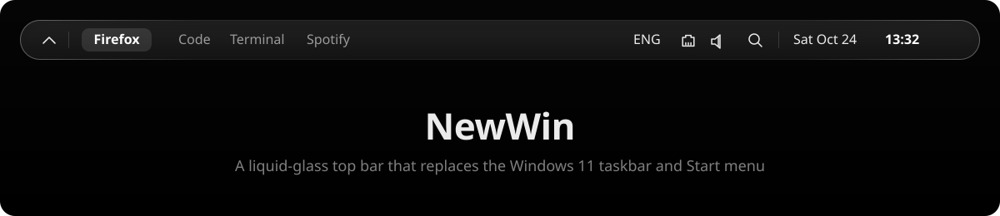

<p align="center">
  
</p>

<p align="center">
  <b>Мінімалістичний монохромний верхній бар із «рідкого скла», що замінює таскбар і меню «Пуск» Windows 11.</b><br>
  Нативний Rust · Win32 · Direct2D · DirectComposition — без Electron, вебвʼю і рантаймів.
</p>

<p align="center">
  <a href="README.md">English</a>
</p>

---

## Навіщо

Зроблено під OLED-монітор і чорні шпалери: **жодних статичних пікселів, жодного кольору, нічого зайвого.** Бар ховається за верхнім краєм і виїжджає, лише коли миша торкається смуги 1–2 px угорі — програми займають увесь екран. Усе — текст і тонкі векторні лінії в «рідкому склі» з власним розмиттям і лінзою по краю.

І він має бути непомітним ще в одному сенсі: ніколи не лагати, не зависати й не падати, а якщо раптом упаде — ви ніколи не лишитеся без панелі.

## Можливості

**Бар**
- Зліва запущені програми з їхніми іконками Windows; активна — жирним у скляній «пігулці», що плавно перетікає між ними.
- Справа розкладка (`ENG` / `UKR`), мережа (Ethernet, Wi-Fi зі справжнім рівнем сигналу, офлайн), гучність, пошук, дата й час.
- **Автоприховування** (з'являється від наведення, програми на весь екран) або **закріплений** режим (займає своє місце, як рідний таскбар; розгорнуті вікна ніколи не залазять під нього).

**Spotlight** — замість «Пуску»
- <kbd>Win</kbd> відкриває скляну панель по центру: пошук програм і системних команд.
- Результати з іконками програм (дві програми з однаковою назвою легко розрізнити), збіг жирним, порядок — за тим, як часто ви щось запускаєте.
- <kbd>↵</kbd> відкрити · <kbd>Ctrl</kbd> + <kbd>↵</kbd> від адміністратора · <kbd>Esc</kbd> закрити.

**Трей**
- `⌃` відкриває список фонових програм (NVIDIA, Discord…) з їхніми іконками трею, названих за їхніми підказками.
- Лівий клік робить те саме, що клік по значку; правий відкриває **рідне меню самої програми** — без підробок.
- Порядок і приховування — у налаштуваннях.

**Налаштування** — `NewWinSettings.exe`
- Те саме скло, шість розділів: *Bar · Appearance · Items · Spotlight · Tray · About*.
- Перемикачі, повзунки, сегментований вибір, список шрифтів, де кожен шрифт намальований собою, перетягування рядків.
- Кнопки «Зберегти» немає: кожна зміна одразу видна на барі.
- Налаштування — звичайний TOML: правте `config.toml` руками, бар підхопить миттєво, а помилка покаже смугу-попередження, нічого не зламавши.

**Страховка**
- Маленький сторож (~1 MB) перезапускає shell, якщо той упав або завис; після 3 падінь за хвилину повертає рідний таскбар.
- `NewWin.exe --restore-taskbar` або *Restore Windows taskbar* у налаштуваннях повертає Windows як було.
- Усі файли пишуться атомарно; release-збірки з `panic = "abort"` не довіряють даним із диска чи інших процесів.

## Швидкодія

Заміряно на машині автора (Windows 11, 16 логічних ядер), див. [нотатки приймання](docs/superpowers/notes/2026-10-23-m4-acceptance.md):

| | Результат |
|---|---|
| CPU, 10 хв простою | **0.0016 %** (shell) · 0.0003 % (сторож) |
| Памʼять (private working set) | **~11 MB** shell · 1.3 MB сторож |
| Перший кадр бару | 55 мс |
| Перший кадр Spotlight | 1–2 мс |
| Перший кадр налаштувань | 10–13 мс |
| Ранжування 1 000 програм | < 1 мс |

Жодного опитування: усе на подіях (WinEvents, сповіщення про зміни, shell hooks). GPU-пристрій для скла прогрівається на вимогу й звільняється після 60 с простою.

## Як запустити

> **Статус:** особистий проєкт, лише Windows 11 і один монітор.

### Встановлення

1. Візьміть `NewWin-Setup-<версія>.exe` — з [Releases](https://github.com/ynujeqax/new_win/releases) або зберіть сам (нижче).
2. Запустіть його. Права адміністратора не потрібні: NewWin ставиться лише для вашого користувача, у `%LOCALAPPDATA%\Programs\NewWin` (папку можна змінити). Інсталятор поки без цифрового підпису, тож SmartScreen може попередити: **Докладніше → Усе одно запустити**.
3. NewWin запускається одразу, а далі — разом із Windows. Новіший інсталятор поверх старого оновлює програму й зберігає налаштування.

**Видалення** — у *Параметри → Програми → Інстальовані програми → NewWin*. Таскбар Windows повертається, а все, що записав NewWin, зникає, разом із налаштуваннями й журналами.

Налаштування відкриваються з трею (`⌃` → **NewWin**), меню бару, Spotlight (`settings` або *NewWin Settings*) або повторним запуском `NewWin.exe`. *Start with Windows* — у Settings → Bar; *Restore Windows taskbar* у Settings → About закриває NewWin і повертає рідний таскбар.

### Збірка з коду

**Потрібно:** Windows 11, [Rust](https://rustup.rs) stable (MSVC); для інсталятора — [Inno Setup 7](https://jrsoftware.org/isdl.php).

```powershell
git clone https://github.com/ynujeqax/new_win.git
cd new_win
cargo build --release --workspace
.\target\release\NewWin.exe                 # запуск із папки збірки
.\scripts\build-installer.ps1               # або зібрати target\installer\NewWin-Setup-<версія>.exe
```

Поки NewWin працює, рідний таскбар схований. Закрити NewWin і повернути таскбар будь-коли:

```powershell
.\target\release\NewWin.exe --quit
```

### Файли

| Шлях | Що |
|---|---|
| `%APPDATA%\NewWin\config.toml` | Усі налаштування; можна правити руками |
| `%APPDATA%\NewWin\usage.toml` | Лічильники запусків для Spotlight |
| `%APPDATA%\NewWin\tray_seen.toml` | Програми, що вже бували в треї |
| `%LOCALAPPDATA%\NewWin\logs\` | Журнали; `NEWWIN_DEBUG=1` — докладні |

## Будова

```
NewWin.exe (сторож) ──запускає──▶ NewWin.exe --shell ◀──config.toml──▶ NewWinSettings.exe
      │ перезапускає після падіння,      │ бар · Spotlight · трей            скляне вікно налаштувань
      │ повертає таскбар                 │ (один UI-потік + малі робітники)  (окремий процес)
```

| Крейт | Роль |
|---|---|
| [`crates/core`](crates/core) | Чиста логіка: ранжування, розкладка, рядки (en/uk), рішення — без Win32, покрито тестами |
| [`crates/config`](crates/config) | Типи конфігу, межі, різниця, атомарні TOML-файли |
| [`crates/platform`](crates/platform) | Win32 / WinRT: вікна, хост трею, звук, мережа, спостерігачі, запуск |
| [`crates/ui`](crates/ui) | Малювання Direct2D / DirectComposition, рідке скло, контроли, вікна |
| [`apps/shell`](apps/shell) | Бар, Spotlight, трей і сторож |
| [`apps/settings`](apps/settings) | `NewWinSettings.exe` |

Специфікації кожної віхи — у [`docs/superpowers/specs`](docs/superpowers/specs), плани — у [`docs/superpowers/plans`](docs/superpowers/plans), виміри й приймання — у [`docs/superpowers/notes`](docs/superpowers/notes).

## План

- [x] **M1** — ядро: бар, автоприховування / закріплення, запущені програми, годинник, сторож
- [x] **Рідке скло** — власне розмиття, лінза по краю, форма капсули
- [x] **M2** — трей, мережа, гучність, розкладка
- [x] **M3** — Spotlight
- [x] **M4** — вікно налаштувань, живий конфіг
- [x] **M5** — інсталятор, видалення з поверненням таскбару, полірування
- [ ] Кілька моніторів

## Розробка

```powershell
cargo test --workspace
cargo clippy --workspace --all-targets
powershell -File scripts\measure.ps1 -Minutes 10   # перевірка бюджету CPU / RAM у простої
```

Скло не видно на скриншотах DXGI, тож вигляд перевіряється очима.

## Ліцензія

[MIT](LICENSE)
