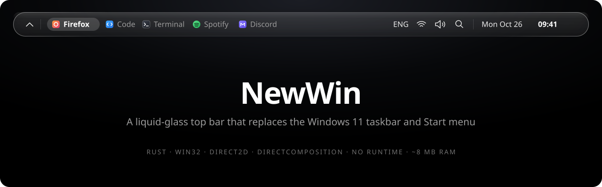
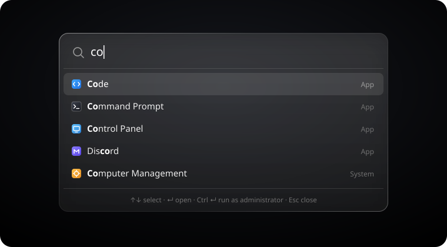
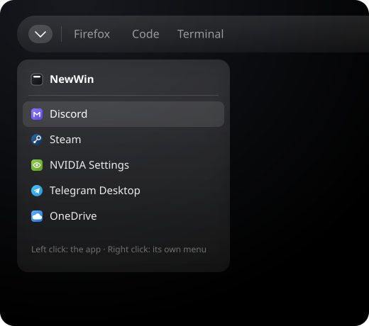
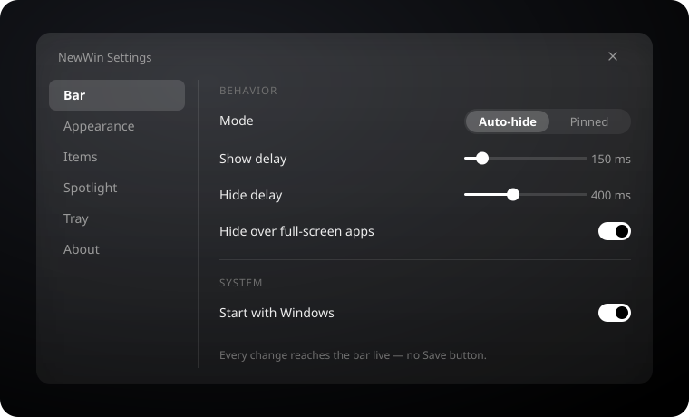

<p align="center">
  
</p>

<p align="center">
  <b>Мінімалістичний монохромний бар із «рідкого скла», що замінює таскбар і меню «Пуск» Windows 11.</b><br>
  Нативний Rust · Win32 · Direct2D · DirectComposition. Без Electron, без веб-вікон, без рантайму.
</p>

<p align="center">
  <a href="https://github.com/ynujeqax/new_win/releases/latest"></a>
</p>

<p align="center">
  
  
  
  
  
  
  
</p>

<p align="center">
  <a href="#можливості">Можливості</a> ·
  <a href="#встановлення">Встановлення</a> ·
  <a href="#швидкодія">Швидкодія</a> ·
  <a href="#архітектура">Архітектура</a> ·
  <a href="README.md">English</a>
</p>

---

## Навіщо

Зроблено під OLED-монітор і чорні шпалери: **жодних статичних пікселів і зайвого, колір лише там, де він щось означає.** Бар ховається за верхнім краєм екрана й виїжджає, лише коли миша торкається смужки в 1–2 px угорі, тож вікнам дістається 100 % екрана. Усе — текст, тонкі векторні лінії та власні іконки програм у «рідкому склі» з власним розмиттям і краєм, як у лінзи.

А ще він має бути непомітним в іншому сенсі: ніколи не лагати, не зависати й не падати. А якщо раптом упаде, ви все одно не лишитеся без таскбару.

## Можливості

<table>
  <tr>
    <td width="58%"></td>
    <td width="42%"></td>
  </tr>
  <tr>
    <td align="center"><sub><b>Spotlight</b>: натисніть <kbd>Win</kbd>, наберіть, <kbd>↵</kbd></sub></td>
    <td align="center"><sub><b>Трей</b>: фонові програми з їхніми власними меню</sub></td>
  </tr>
</table>

### Бар
- **Запущені програми** зліва, кожна зі своєю іконкою Windows. Активна — жирним, у скляній «пігулці», що плавно перетікає між програмами.
- Клік перемикає, згортає чи розгортає; середній клік закриває; у програми з кількома вікнами — список. Правий клік: *Нове вікно* і *Закрити*.
- **Справа:** розкладка (`ENG` / `UKR`), мережа (Ethernet, Wi-Fi зі справжнім рівнем сигналу, офлайн), гучність (коліщатко змінює, середній клік вимикає звук, клік відкриває повзунок і вибір пристрою), пошук, дата й час (клік — центр сповіщень).
- **Автоприховування** (з'являється від наведення) або **закріплений** режим (займає своє місце, як рідний таскбар, тож розгорнуті вікна не залазять під нього). Повноекранним програмам він теж не заважає.
- Правий клік по порожньому місцю відкриває повне **меню Win+X**: диспетчер пристроїв, PowerShell (адміністратор), диспетчер завдань, «Виконати», вимкнення тощо.

### Spotlight — замість «Пуску»
- <kbd>Win</kbd> або <kbd>Ctrl</kbd> + <kbd>Esc</kbd> відкриває скляну панель по центру. Пошук програм і системних команд (*Завершити роботу*, *Перезавантажити*, *Сон*, *Заблокувати*, *Вийти*, *Налаштування NewWin*).
- Результати з іконками програм. Дві програми з однаковою назвою легко розрізнити, а збіг виділено жирним.
- Порядок — за тим, як часто ви щось запускаєте. Нові програми з'являються одразу після встановлення.
- <kbd>↵</kbd> відкрити · <kbd>Ctrl</kbd> + <kbd>↵</kbd> від адміністратора · правий клік: *Відкрити розташування файлу* · <kbd>Esc</kbd> закрити.

### Трей
- `⌃` відкриває список фонових програм (Discord, Steam, NVIDIA…) з їхніми іконками трею, названих за їхніми підказками.
- Лівий клік робить те саме, що клік по значку. Правий відкриває **рідне меню самої програми**, без підробок.
- Порядок і приховування — у налаштуваннях.

<p align="center">
  
</p>

### Налаштування — `NewWinSettings.exe`
- Те саме скло, шість розділів: *Панель · Вигляд · Елементи · Spotlight · Трей · Про програму*.
- Перемикачі, повзунки, сегментований вибір, список шрифтів, де кожен шрифт намальований ним самим, і перетягування рядків.
- **Кнопки «Зберегти» немає.** Кожна зміна з'являється на барі менш ніж за секунду.
- Налаштування — звичайний TOML. Правте `config.toml` руками, і бар підхопить зміни миттєво, а помилка покаже смугу-попередження, нічого не зламавши.
- Англійською й українською, за мовою інтерфейсу Windows.

### Страховка
- Маленький сторож (~1 MB) перезапускає shell, якщо той упав або завис. Після 3 падінь за хвилину він повертає рідний таскбар.
- `NewWin.exe --quit`, *Вийти з NewWin* у меню бару чи *Повернути таскбар Windows* у налаштуваннях повертають Windows як було. Видалення програми теж.
- Іконки Windows дістає короткоживучий процес-помічник, який сам виходить після 30 с без запитів. Завислий компонент Windows коштує щонайбільше 5 с і ніколи не заморожує бар.
- Усі файли пишуться атомарно. Release-збірки з `panic = "abort"` не довіряють даним із диска чи з інших процесів.

## Встановлення

1. Завантажте **`NewWin-Setup-1.0.2.exe`** з [Releases](https://github.com/ynujeqax/new_win/releases/latest) або [зберіть самі](#збірка-з-коду).
2. Запустіть. Права адміністратора не потрібні: NewWin ставиться лише для вашого користувача, у `%LOCALAPPDATA%\Programs\NewWin` (папку можна змінити). Інсталятор поки не підписаний, тож SmartScreen може попередити: **Докладніше → Усе одно запустити**.
3. NewWin запускається одразу, а далі — разом із Windows. Новіший інсталятор поверх старого оновлює програму й зберігає налаштування.

Тихе встановлення для скриптів: `NewWin-Setup-1.0.2.exe /VERYSILENT /DIR="C:\Programs\NewWin"`.

**Видалення:** *Параметри → Програми → Інстальовані програми → NewWin*. Таскбар Windows повертається, а все, що записав NewWin (налаштування й журнали), видаляється.

Налаштування відкриваються з трею (`⌃` → **NewWin**), з меню бару, зі Spotlight (`settings`) або повторним запуском `NewWin.exe`.

### Клавіші й кліки

| | |
|---|---|
| <kbd>Win</kbd> · <kbd>Ctrl</kbd> + <kbd>Esc</kbd> | Spotlight (увімкнено за замовчуванням; див. Налаштування → Spotlight) |
| Клік по програмі | Перейти до неї · згорнути, якщо активна · список, якщо вікон кілька |
| Середній клік по програмі | Закрити її |
| Правий клік по порожньому бару | Меню Win+X, налаштування NewWin, перезапуск / вихід |
| Коліщатко / середній клік на гучності | Змінити гучність / вимкнути звук |
| Клік по даті | Центр сповіщень |
| Клік по `ENG` | Наступна розкладка |

## Швидкодія

Заміряно на машині автора (Windows 11, 16 логічних ядер).

| | Результат |
|---|---|
| Пам'ять shell (private working set, 1.0.1) | **~8 MB**, 19 потоків |
| Пам'ять помічника іконок (лише поки дістає іконки) | 2.6 MB; виходить через 30 с після останнього запиту |
| Пам'ять сторожа | 1.3 MB |
| CPU, 10 хв простою (1.0.0) | **0.0016 %** shell · 0.0003 % сторож |
| Перший кадр бару | 55 мс |
| Перший кадр Spotlight / трею | ~1 мс |
| Перший кадр налаштувань | 10–13 мс |
| Ранжування 1 000 програм | < 1 мс |

Нічого не опитується за таймером: усе працює від подій (WinEvents, сповіщення про зміни, shell-хуки). GPU-пристрій для скла піднімається на вимогу й звільняється після 60 с бездіяльності.

## Збірка з коду

**Потрібно:** Windows 11, [Rust](https://rustup.rs) stable (MSVC) і [Inno Setup 7](https://jrsoftware.org/isdl.php) для інсталятора.

```powershell
git clone https://github.com/ynujeqax/new_win.git
cd new_win
cargo build --release --workspace
.\target\release\NewWin.exe                 # запуск просто з папки збірки
.\scripts\build-installer.ps1               # або зібрати target\installer\NewWin-Setup-<версія>.exe
```

Поки NewWin працює, рідний таскбар прихований. Вийти з NewWin і повернути його можна будь-коли:

```powershell
.\target\release\NewWin.exe --quit
```

### Файли

| Шлях | Що це |
|---|---|
| `%APPDATA%\NewWin\config.toml` | Усі налаштування; можна правити руками |
| `%APPDATA%\NewWin\usage.toml` | Лічильники запусків для порядку в Spotlight |
| `%APPDATA%\NewWin\tray_seen.toml` | Програми, що вже бували в треї (назви для налаштувань) |
| `%LOCALAPPDATA%\NewWin\logs\` | Журнали; `NEWWIN_DEBUG=1` — докладні |

## Архітектура

```
NewWin.exe  (сторож)                       перезапускає shell після падіння чи зависання,
   │                                       повертає таскбар після 3 падінь
   └─▶ NewWin.exe --shell                  бар · Spotlight · хост трею · панелі
          │   один UI-потік + невеликі робочі (скло, хук клавіатури, worker)
          ├─▶ NewWin.exe --icon-helper     іконки Windows через stdin/stdout, виходить без роботи
          └─◀ config.toml ─▶ NewWinSettings.exe    скляне вікно налаштувань, окремий процес
```

| Крейт | Роль |
|---|---|
| [`crates/core`](crates/core) | Чиста логіка: ранжування, розкладка, протокол трею, рядки (en/uk), рішення. Без Win32, повністю покрита тестами |
| [`crates/config`](crates/config) | Типи налаштувань, межі, порівняння, атомарні TOML-файли |
| [`crates/platform`](crates/platform) | Win32 / WinRT: вікна, хост трею, іконки, звук, мережа, спостерігачі, запуск програм |
| [`crates/ui`](crates/ui) | Рендеринг Direct2D / DirectComposition, «рідке скло», елементи керування, вікна |
| [`apps/shell`](apps/shell) | Бар, Spotlight, панель трею, сторож і помічник іконок (`NewWin.exe`) |
| [`apps/settings`](apps/settings) | `NewWinSettings.exe` |

## План

- [x] **M1**: ядро shell (бар, автоприховування / закріплення, запущені програми, годинник, сторож)
- [x] **Рідке скло**: власне розмиття, край-лінза, форма капсули
- [x] **M2**: трей, мережа, гучність, розкладка клавіатури
- [x] **M3**: Spotlight
- [x] **M4**: вікно налаштувань, живий конфіг
- [x] **M5**: інсталятор, видалення з поверненням таскбару, шліфування
- [x] **1.0.1**: кольорові іконки програм на барі, у Spotlight і в треї
- [x] **1.0.2**: анімації всюди (підсвітка, що ковзає, пігулки програм, що з'їжджають, годинник, що прокручується), нові іконки Wi-Fi і звуку, назви Steam-ігор одразу
- [ ] Кілька моніторів

## Розробка

```powershell
cargo test --workspace
cargo clippy --workspace --all-targets
powershell -File scripts\measure.ps1 -Minutes 10   # перевірка бюджету CPU / RAM у простої
```

Скло невидиме для DXGI-скриншотів, тож вигляд перевіряється очима. Картинки в цьому README намальовані за справжнім інтерфейсом.

## Ліцензія

[MIT](LICENSE)
